# Ames Housing Price Prediction

End-to-end machine-learning pipeline that predicts residential sale prices in Ames, Iowa (Kaggle-style House Prices competition).

**Target environment:** Python 3.14  
**Primary metric:** RMSE on `log1p(SalePrice)`  
**Final ensemble OOF performance:** RMSE (log) ≈ **0.129** · RMSE ($) ≈ **$29,250** · R² ≈ **0.864**

---

## Project structure

```
artifacts/
├── Datasets/
│   ├── train.csv                 # 1,460 homes with SalePrice
│   ├── test.csv                  # 1,459 homes (no target)
│   ├── sample_submission.csv
│   ├── data_description.txt      # Full feature dictionary
│   └── processed/                # Clean matrices after FE & selection
│       ├── X_train_selected.csv  # 80 features
│       ├── X_test_selected.csv
│       ├── y.csv / y_log.csv
│       └── selected_features.csv
├── Kernels/                      # Analysis notebooks (phases 01–06)
│   ├── 01_EDA.ipynb              # Styled HTML titles, sections, callouts
│   ├── 02_Feature_Engineering.ipynb
│   ├── 03_Visualizing_Dashboards.ipynb
│   ├── 04_Feature_Selection.ipynb
│   ├── 05_Model_Training.ipynb
│   └── 06_Apply_Test.ipynb
├── Reports/
│   ├── 07_Management_Review.pptx # 14-slide management review deck
│   ├── 07_Management_Review.pdf  # PDF version of the same deck
│   ├── submission.csv            # Final test predictions
│   ├── eda_figures/              # EDA charts
│   ├── viz_figures/              # Post-FE visualizations
│   ├── selection_figures/
│   ├── model_figures/
│   └── models/                   # joblib artefacts
├── requirements.txt
└── README.md
```

---

## Notebook design system

All phase notebooks (`Kernels/01`–`06`) use a shared HTML/CSS design language aligned with the management deck:

| Element | Style |
|---------|--------|
| **Title block** | Navy gradient header, white title, teal meta line, rounded card shadow |
| **Section heads** | Cream background, teal left border, navy heading text |
| **Body boxes** | White card, light border, soft shadow |
| **Callouts** | Teal-tinted background, teal left border (insights / notes) |
| **Warnings** | Coral-tinted background, coral left border |
| **Summary panels** | Navy background, teal headings, gold highlights, styled tables |
| **Next-phase links** | Dashed teal border, cream background |

**Palette:** Navy `#1B3A4B` · Teal `#2A9D8F` · Coral `#E76F51` · Gold `#E9C46A` · Cream `#F7F4EF` · Muted `#6B6560`

Open any notebook in JupyterLab / VS Code to see the styled markdown render.

---

## Data

| File | Rows | Columns | Description |
|------|------|---------|-------------|
| `train.csv` | 1,460 | 81 | Labeled sales (includes `SalePrice`) |
| `test.csv` | 1,459 | 80 | Unlabeled sales for submission |
| `data_description.txt` | — | — | Official codebook for every feature |

**Target:** `SalePrice` (USD). Strongly right-skewed → modeling uses `log1p(SalePrice)`.

**Key raw drivers (Pearson correlation with SalePrice):**

| Feature | Corr. |
|---------|-------|
| OverallQual | 0.79 |
| GrLivArea | 0.71 |
| GarageCars | 0.64 |
| GarageArea | 0.62 |
| TotalBsmtSF | 0.61 |
| 1stFlrSF | 0.61 |

---

## Analytics phases

### 01 — Exploratory Data Analysis

- Schema & dtypes, missing-value audit, target distribution  
- Correlation heatmap and top predictors  
- Neighborhood price effects, temporal patterns, outlier screening  

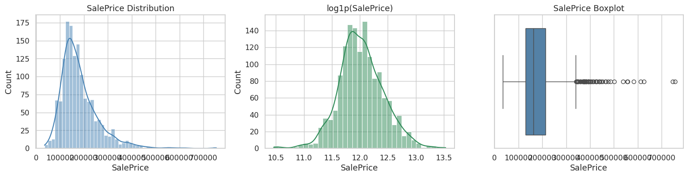

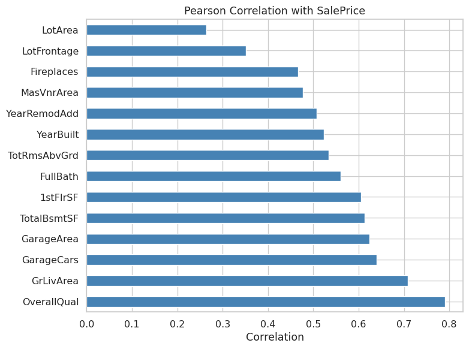

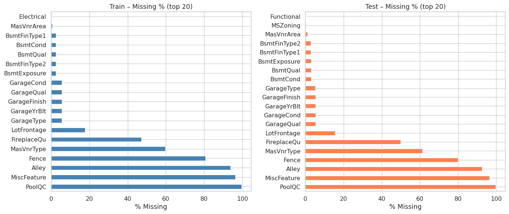

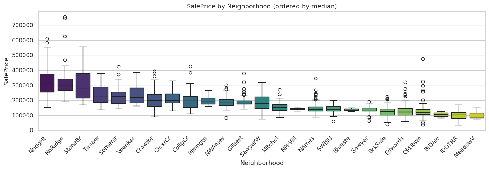

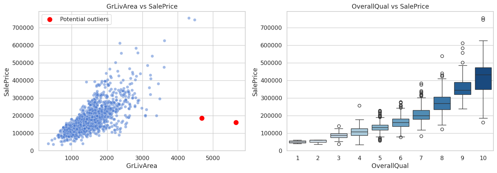

### 02 — Feature Engineering

Domain-aware imputation (“None” / 0 for absence features, neighborhood-median `LotFrontage`), derived features (`TotalSF`, `HouseAge`, `TotalBath`, binary flags, quality composites), ordinal encoding of quality/condition variables, one-hot for remaining nominals, and `log1p` transforms for skewed continuous columns.

**Result:** 212 model-ready features.

### 03 — Visualizing & Dashboards

Post-FE diagnostics, engineered-feature vs target plots, binary-flag impact, and a quick Random-Forest importance ranking.

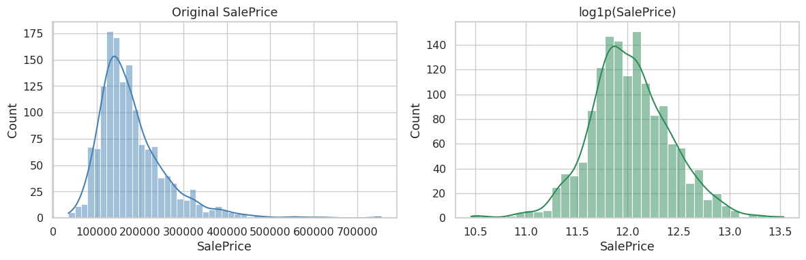

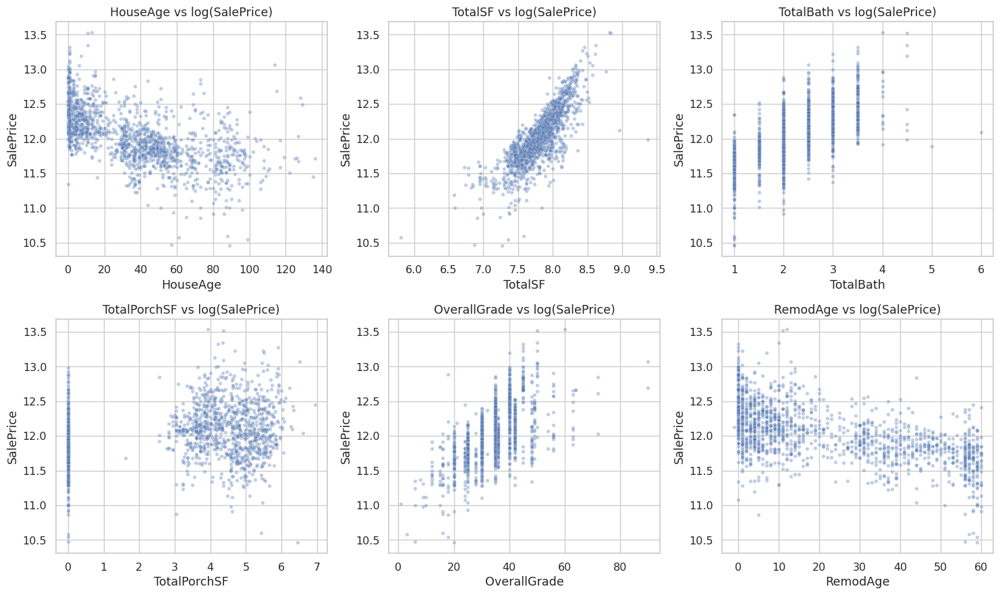

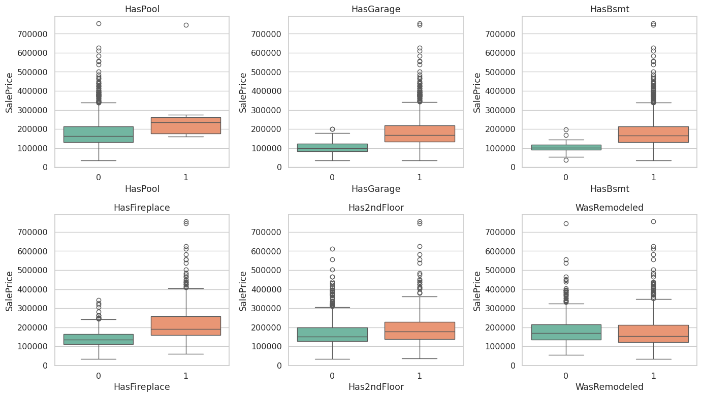

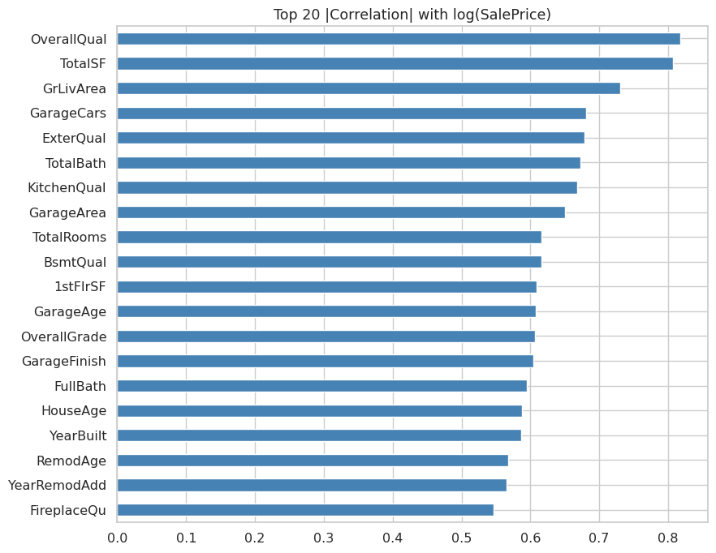

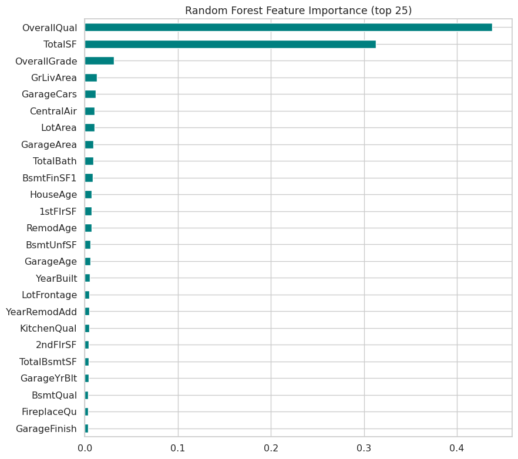

### 04 — Feature Selection

1. Variance threshold  
2. Drop pairs with |corr| > 0.95  
3. Mutual-information ranking  
4. Recursive Feature Elimination (Random Forest) → **80 features**

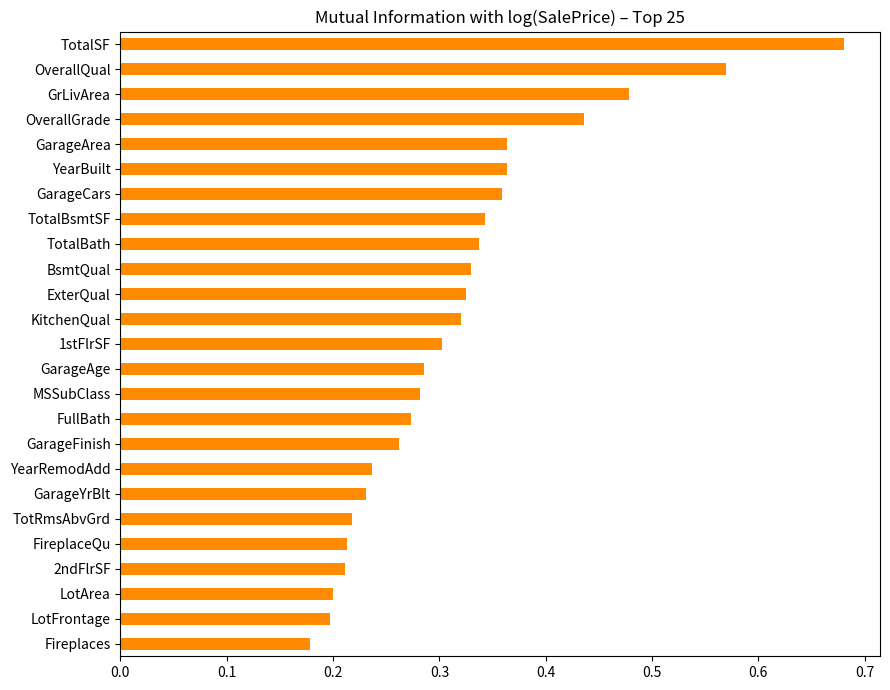

### 05 — Model Training

| Model | 5-fold CV RMSE (log) |
|-------|----------------------|
| Ridge (tuned α=50) | ≈ 0.132 |
| HistGradientBoosting (tuned) | ≈ 0.133 |
| GradientBoosting | ≈ 0.134 |
| RandomForest | ≈ 0.140 |
| **Ensemble average** | **≈ 0.129** |

OOF absolute metrics: MAE ≈ **$15,200**, RMSE ≈ **$29,250**, R² ≈ **0.864**.

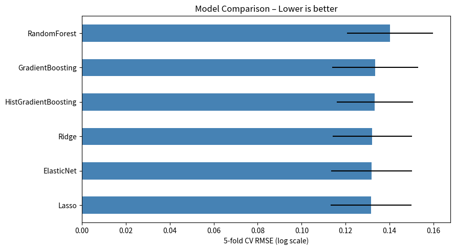

### 06 — Apply on Test Data

Ensemble predictions (`expm1` of averaged log predictions) written to `Reports/submission.csv`.

### 07 — Management Review Presentation

14-slide detailed executive deck (`Reports/07_Management_Review.pptx` + `.pdf`) with embedded charts:

1. Title (KPI strip)  
2. Agenda  
3. Executive summary + decision ask  
4. Business context  
5. Data profile (distributions + missingness charts)  
6. Key drivers (correlation & relationship charts)  
7. Location & time (neighborhood chart)  
8. Feature engineering pipeline  
9. Feature selection + RF importance chart  
10. Model performance (CV chart + table + OOF metrics)  
11. Engineered features vs target  
12. Test predictions & delivery package  
13. Recommendations (owners + timing)  
14. Closing / Q&A  

---

## Quick start

```bash
# Python 3.14 recommended
python3.14 -m venv .venv
source .venv/bin/activate
pip install -r requirements.txt

# Explore notebooks (styled markdown renders in JupyterLab / VS Code)
jupyter lab Kernels/

# Or re-run the full pipeline from the notebooks in order (01 → 06)
```

Trained models live in `Reports/models/` (`best_hgb.joblib`, `best_ridge.joblib`, `rf.joblib`, `gbm.joblib`).

---

## Key findings & recommendations

- **OverallQual**, **TotalSF** (engineered), **HouseAge**, garage capacity, and kitchen/exterior quality are the dominant drivers.
- High missingness on Pool / Alley / Fence / MiscFeature is informative (“None”); treat accordingly rather than dropping rows.
- A simple average of four diverse regressors outperforms any single model and is the recommended production scorer.
- Monitor residual RMSE on new sales; retrain when drift exceeds ~15 %.

---

*Generated as part of the professional data-analysis pipeline. All notebooks (HTML-styled), processed data, models, figures, and the management deck are self-contained under this repository.*
